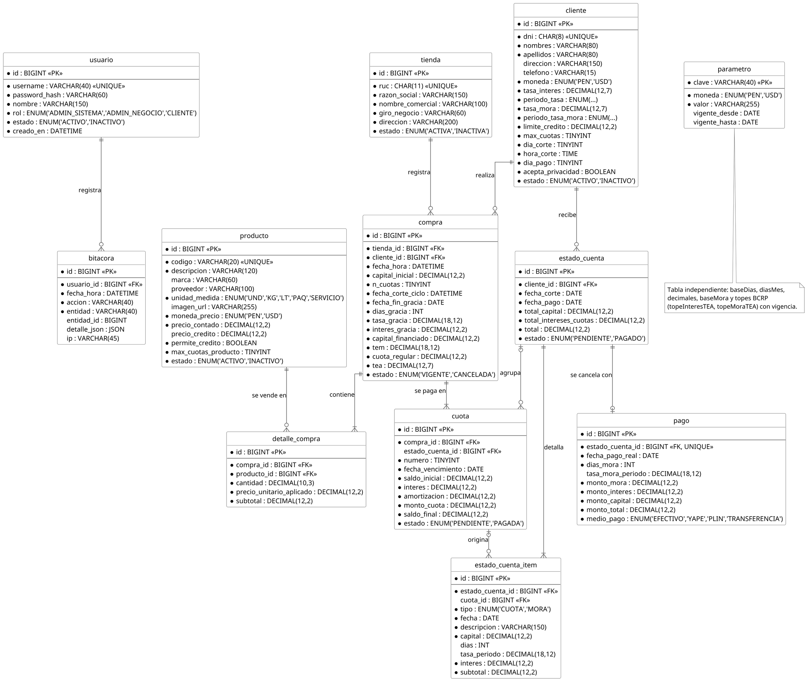

# Fiadito — Contexto del proyecto para desarrollo

> ## DECISIONES DE ALCANCE (2026-11-01) — prevalecen sobre el resto de este documento
> Fiadito es para **créditos pequeños de tiendas de barrio**. No se sobredimensiona:
> - **Solo soles (PEN).** No hay USD ni selector de moneda.
> - **Importes pequeños:** límite de crédito por cliente **≤ S/ 250**, producto ≤ S/ 250, hasta **12 cuotas**.
> - **Solo tasa efectiva.** No existe tasa nominal (se ignora todo lo que este documento dice de nominal / `tipoTasa` / `capitalizacion`).
> - **No existe TCEA**, solo **TEA** (`compra.tea`). Sin comisiones, seguros ni gastos.
> - **Topes de TEA realistas** (configurables en Parámetros): interés **60 %**, mora **15 %** (referenciales).
> - **Dos tipos de usuario:** `ADMIN_SISTEMA` y `ADMIN_NEGOCIO` (quien maneja la tienda). **Los clientes no tienen usuario ni acceso**: el administrador de la tienda registra las compras y les entrega el cronograma de pagos.
> - **Pantallas:** Inicio, Productos, Clientes, Compras, **Cronograma de pagos**, Estado de cuenta, Parámetros (+ Tiendas para el administrador del sistema). No hay pantallas de Pagos, Bitácora ni Cómo funciona (la bitácora se sigue registrando en la BD).
> - **Cronograma de pagos:** cronograma del método francés por compra, con **días de gracia editables** (recalcula y guarda mientras no se haya pagado ninguna cuota ni exista estado de cuenta), **días de mora** y botón **Pagar** que cobra la próxima cuota completa (mora → interés → capital, sin pagos parciales ni duplicados). El pago es **por cuota**; el estado de cuenta es el documento del corte y pasa a PAGADO cuando todas sus cuotas están pagadas.


> Documento de contexto para Claude Code. Resume el enunciado del curso, el informe del Hito 1 (ya corregido) y las reglas financieras que el código debe cumplir **exactamente**. Ante cualquier duda de cálculo, manda este documento y los datos de prueba de la sección 8.

---

## 1. Qué es el proyecto

- **Curso:** SI642 Finanzas e Ingeniería Económica — UPC, ciclo 2026-20, sección 7672. Profesor: José Ismael Vásquez Neyra.
- **Equipo:** Hurtado Balcazar Rommel Daniel (U202517474), Higa Kohatsu Alonso Enrique (U202416276), Mansilla Rivero Carlos Marcelo (U202414510), Valdez Jaramillo Alberto Antonio (U202313735), Glenni Carmelino Jorge Sebastian (U202019410).
- **Producto:** **Fiadito**, aplicación web que reemplaza el "cuaderno de fiado" de negocios de barrio (bodegas, panaderías, pollerías, peluquerías, spa, etc.). Lleva la cuenta corriente de los créditos que la tienda otorga a sus vecinos.
- **Enfoque:** desde el punto de vista del **comercio que da el crédito**.
- **Entregas:**
  - Hito 1 (semana 7): informe de análisis y diseño. ✅ Entregado y corregido.
  - **Hito 2 (semana 15): aplicación web o móvil funcionando** ← lo que toca construir ahora. Se entrega con código fuente comprimido, PPT (herramientas, lenguajes, BD, hosting, URL si está desplegada, requisitos de hardware), informe Word y un video de ≤ 20 min.

### Corrección del profesor ya aplicada
- **No existe TCEA.** Los créditos no tienen comisiones, seguros ni gastos. El único indicador de costo que se muestra es la **TEA** (tasa efectiva anual equivalente a la tasa pactada). No hay que implementar el cálculo de TCEA (TIR o Newton) ni guardar una columna `tcea`. En la BD el campo es `compra.tea`.

---

## 2. Requisitos obligatorios del enunciado

1. **Administrador del sistema:** da de alta y de baja a las tiendas (credenciales y datos). Se accede por perfil con usuario y clave: el **cliente** consulta y el **administrador del negocio** gestiona.
2. **Administrador del negocio, productos/servicios:** alta y baja con proveedor (si aplica), marca, descripción, unidad de medida, **imagen**, **precio contado**, **precio de lista (crédito)**, y si se puede vender en un solo pago a fin de mes (fecha de corte) o en meses.
3. **Administrador del negocio, clientes:** datos generales más la **tasa pactada (nominal o efectiva)**, la moneda, el límite de crédito, el máximo de meses, el **día de corte** y el **día de pago** mensual.
4. **Pagos en meses:** **método francés vencido simple ordinario, meses de 30 días**, con **periodo de gracia total** desde la compra hasta la fecha de pago del ciclo. La deuda se capitaliza antes de calcular la cuota.
   - Ejemplo del enunciado: compra el 15/09, corte el 20/09, pago los 26. Hay 11 días de gracia total y la deuda se capitaliza. En 3 cuotas, vencen el 26/10, 26/11 y 26/12.
5. **Compras a fin de mes (pago único)** hechas antes de la fecha y hora de corte: pagan interés por los días entre la compra y la fecha de pago, y además **mora** por los días entre la fecha pactada y el pago real.
   - Una compra hecha después del corte pasa al mes siguiente.
   - **No se permiten compras que excedan el límite** ni **pagos parciales**.
6. **En la fecha de corte** se genera el listado de pago (estado de cuenta) de cada cliente: compras ordenadas por fecha e intereses acumulados. La mora se muestra como un **ítem separado "intereses por mora"**, calculado con la tasa moratoria pactada (nominal o efectiva).
7. **Login con usuario y password obligatorio.** Se deben registrar **todas las operaciones en la BD** (bitácora).
8. **Multi-tienda:** el sistema debe ser genérico y permitir que **varias tiendas de distintos giros operen a la vez** en la misma plataforma.
9. Cada campo de los formularios debe tener **ayuda en línea** (tooltip o texto de ayuda).
10. **No es necesario:** inventario o stock, ni impuestos (IGV, renta).

### Anexo A — Convenciones de cálculo, obligatorias e idénticas para todos los grupos
- Base de **360 días**, mes comercial de **30 días**. Fórmula de conversión explícita para tasa nominal y efectiva.
- **Prelación de pagos:** mora → interés compensatorio → capital.
- **Redondeo:** importes a **2 decimales**. Tasas con **al menos 7 decimales** (internamente, precisión completa).

---

## 3. Discrepancias entre el informe y el enunciado (decidir antes de codificar)

| # | Tema | Enunciado | Informe Hito 1 | Sugerencia |
|---|---|---|---|---|
| 1 | Tipo de tasa | Puede ser **nominal o efectiva** (compensatoria y moratoria) | Solo modela tasas **efectivas** con periodo (DIARIA…ANUAL) | Agregar `tipoTasa` (NOMINAL/EFECTIVA) y `capitalizacion` para la nominal, y convertir a TE con `TE = (1 + TN/m)^n − 1`. Ver 5.2. |
| 2 | Pago único a fin de mes | Interés **desde la compra hasta la fecha de pago** del ciclo; vence en esa fecha | Trata `nCuotas = 1` como francés: gracia hasta la fecha de pago y la cuota vence **un mes después** (ej. CM2: 03/09 → cuota 26/10) | Distinguir dos modalidades: `PAGO_UNICO` (vence en `fechaFinGracia`, monto = C·(1+TE_d)) y `CUOTAS` (francés con gracia). Confirmar con el profesor. |
| 3 | Alcance | Multi-tienda, 3 roles (admin sistema, admin negocio, cliente) | La introducción dice "una sola bodega, un solo usuario" | El modelo de datos ya soporta multi-tienda y 3 roles: implementar eso. |
| 4 | Imagen de producto | Obligatoria | `imgUrl` (URL) | Permitir subir la imagen o guardar la URL. |

---

## 4. Roles y pantallas (prototipo del Hito 1)

Roles: `ADMIN_SISTEMA`, `ADMIN_NEGOCIO`, `CLIENTE`. Cada cuenta ve solo lo suyo.

Pantallas diseñadas (menú lateral verde oscuro, marca "Fiadito / Bodega Don Lucho"):
1. **Landing / login:** "El cuaderno de fiado, ahora con cuentas claras."
2. **Inicio (dashboard):** deuda por cobrar, crédito disponible, vence el próximo día de pago, en mora. Tabla de clientes, próximos vencimientos y compras recientes.
3. **Productos:** listado y formulario (código, descripción, unidad, marca, proveedor, imagen, precio contado, precio crédito referencial, permite crédito, máximo de cuotas, estado).
4. **Clientes:** listado (tasa pactada, TEA, límite, deuda, corte/pago, estado) y formulario. El formulario incluye un panel "Lo que calcula la app" con p, pMora, TEM, TEA mora y TEA equivalente, y valida contra los topes BCRP.
5. **Compras:** listado y "Nueva compra al crédito": cliente, fecha y hora, productos, número de cuotas. Muestra en vivo: capital, corte del ciclo, días de gracia, interés de gracia, capital financiado, TEM, **TEA**, cuota regular, mini-cronograma y crédito disponible después de la compra.
6. **Estado de cuenta:** por corte. Detalle de cuotas, total capital, total intereses de cuotas, intereses por mora y TOTAL A PAGAR. Se puede imprimir o exportar a .txt.
7. **Pagos:** estado de cuenta, fecha pactada, fecha real, medio de pago (EFECTIVO/YAPE/PLIN/TRANSFERENCIA) y monto. Muestra el cálculo: días de mora, tasa de mora del periodo, interés moratorio, total a pagar y la imputación (mora → interés → capital).
8. **Parámetros:** datos de la tienda, base de cálculo (360/30, decimales, baseMora = TOTAL_VENCIDO) y topes BCRP por moneda con vigencia.
9. **Cómo funciona:** ayuda con los pasos y las fórmulas.

> Las capturas del prototipo todavía muestran "TCEA" en algunas pantallas. En el código, **reemplazar por TEA**.

---

## 5. Modelo financiero (implementar tal cual)

Notación: `red₂(x)` = redondeo a 2 decimales con **medio céntimo hacia arriba** (ROUND_HALF_UP). Las tasas se manejan en decimal con precisión completa (usar `Decimal`/`BigDecimal`, **nunca float** para importes).

### 5.1 Periodos (días)
DIARIA 1 · QUINCENAL 15 · MENSUAL 30 · BIMESTRAL 60 · TRIMESTRAL 90 · CUATRIMESTRAL 120 · SEMESTRAL 180 · ANUAL 360.
`p` = días del periodo de `tasaInteres`; `pMora` = días del periodo de `tasaMora`.

### 5.2 Conversión de tasas
```
i  = tasaInteres / 100        im = tasaMora / 100
TE_d = (1 + i)^(d/p) − 1                     # efectiva de p días → d días
TEM  = (1 + i)^(30/p) − 1
teaInteresDecimal = (1 + i)^(360/p) − 1      # teaEquivalente = 100 × esto
teaMoraDecimal    = (1 + im)^(360/pMora) − 1
```
Si se agrega la tasa **nominal** (pendiente, ver sección 3): `TE_periodo = (1 + TN/m)^(n) − 1`, donde `m` = número de capitalizaciones en el plazo de la TN y `n` = número de capitalizaciones en el periodo destino (base 360/30). Después se usa igual que una efectiva.

Validación: `teaInteres% ≤ topeInteresTEA` y `teaMora% ≤ topeMoraTEA` vigentes para la moneda (Circular BCRP 0008-2021: tope moratorio = 0.15 × tope compensatorio). Los valores de los topes se configuran, no se fijan en el código.

### 5.3 Días entre fechas (30E/360)
```
d = 360(A2 − A1) + 30(M2 − M1) + (D2 − D1),  con D = min(día, 30)
```

### 5.4 Ciclo y fechas
- `fechaCorteCiclo` = primer corte (díaCorte + horaCorte) **≥ fechaHoraCompra**. Si la compra es posterior a la hora de corte, pasa al mes siguiente (las 23:59 del día de corte todavía entran; las 00:00 del día siguiente ya no).
- `fechaFinGracia` = primer día de pago **posterior** a ese corte.
- `diasGracia` = días 30E/360 entre la fecha de compra y `fechaFinGracia`.
- `fechaPrimeraCuota` = `fechaFinGracia` + 1 mes. Las siguientes vencen mensualmente.
- Si el día no existe en el mes (31, 30 en febrero), se usa el **último día del mes**, conservando el día pactado en los meses siguientes (ej.: 28/02/2027 y luego 31/03/2027).

### 5.5 Capital y gracia total
```
subtotal_j = red₂(cantidad_j × precioUnitarioAplicado_j)   # precioUnitarioAplicado = precioContado al momento de la compra
C = Σ subtotal_j
tasaGracia = (1 + i)^(diasGracia/p) − 1
capitalFinanciado (Cg) = red₂(C × (1 + tasaGracia))
interesGracia = Cg − C
```
`precioCredito` es **solo referencial**: no entra en los cálculos.

### 5.6 Método francés
```
R = red₂( Cg × TEM / (1 − (1 + TEM)^(−n)) )     # si TEM = 0 → R = red₂(Cg / n)
S0 = Cg
para k = 1..n:
  I_k = red₂(S_{k−1} × TEM)
  si k < n: A_k = R − I_k ; R_k = R
  si k = n: A_n = S_{n−1} ; R_n = A_n + I_n      # la última cuota ajusta el redondeo
  S_k = S_{k−1} − A_k
totalInteresesCompra = interesGracia + Σ I_k
totalProgramadoCompra = Σ R_k = C + totalInteresesCompra
```

### 5.7 Estado de cuenta (se genera en cada fecha de corte)
- Incluye las cuotas **pendientes** que vencen en la fecha de pago de ese ciclo, **ordenadas por fecha de compra**.
- `totalCapital = Σ A_k`, `totalInteresesCuotas = Σ I_k`.
- Las compras cuya primera cuota vence después se muestran solo como información.
- Las obligaciones de ciclos anteriores conservan su vencimiento original para calcular la mora.

### 5.8 Mora y pago
```
diasMora = max(0, días30E/360(vencimiento, fechaPagoReal))
tasaMoraPeriodo = (1 + im)^(diasMora/pMora) − 1
moraObligacion = red₂(saldoVencido × tasaMoraPeriodo)    # saldoVencido = capital + interés de la cuota, sin mora anterior (baseMora = TOTAL_VENCIDO)
interesesMora = Σ moraObligacion
totalPagar = totalCapital + totalInteresesCuotas + interesesMora
```
- El pago debe ser **exactamente** `totalPagar`. Si no, se rechaza (no hay pagos parciales).
- Imputación: mora → intereses de cuotas → capital.
- No se puede pagar dos veces un estado de cuenta cancelado.

### 5.9 Límite de cuotas y crédito
- `maxCuotasPermitidas = min(cliente.maxCuotas, min(producto.maxCuotasProducto de cada ítem))`. Debe cumplirse `1 ≤ nCuotas ≤ maxCuotasPermitidas`.
- `deudaPendiente = Σ capitalFinanciado de las compras − Σ amortizaciones pagadas` (sin intereses futuros ni mora).
- `creditoDisponible = limiteCredito − deudaPendiente`. La compra se acepta si `Cg ≤ creditoDisponibleAntes`.
- Al pagar, el crédito disponible aumenta **solo** en la amortización pagada.

### 5.10 Validaciones de producto
Un producto `INACTIVO` o con `permiteCredito = FALSE` no se puede comprar al crédito.

---

## 6. Datos de entrada (resumen de tipos)

- **Tienda:** ruc CHAR(11), razonSocial VARCHAR(150), nombreComercial VARCHAR(100), giroNegocio VARCHAR(60), direccion VARCHAR(200), estadoTienda ACTIVA/INACTIVA. La baja es lógica: conserva el historial y bloquea compras nuevas.
- **Usuario:** username VARCHAR(40) único, password → **hash BCrypt** (`password_hash`), nombre, rol, estado ACTIVO/INACTIVO.
- **Producto:** codigo VARCHAR(20), descripcion VARCHAR(120), marca, proveedor, unidadMedida (UND/KG/LT/PAQ/SERVICIO), imgUrl, monedaPrecio (PEN/USD), precioContado DECIMAL(12,2), precioCredito DECIMAL(12,2), permiteCredito BOOL, maxCuotasProducto TINYINT, estado.
- **Cliente:** dni CHAR(8), nombres, apellidos, direccion, telefono, moneda, tasaInteres DECIMAL(12,7), periodoTasa, tasaMora DECIMAL(12,7), periodoTasaMora, limiteCredito DECIMAL(12,2), maxCuotas, diaCorte, horaCorte TIME, diaPago, aceptaPrivacidad BOOL (Ley 29733), estadoCliente.
- **Compra:** tiendaId, clienteId, fechaHoraCompra DATETIME, items[{codigoProducto, cantidad DECIMAL(10,3), precioUnitarioAplicado}], nCuotas.
- **Pago:** estadoCuentaId, fechaPagoReal, montoPagado, medioPago.
- **Parámetros:** baseDias = 360, diasMes = 30, decimalesMoneda = 2, decimalesTasaMinimos = 7, baseMora = TOTAL_VENCIDO, topes por moneda (topeInteresTEA, topeMoraTEA) con vigenciaDesde/vigenciaHasta.

---

## 7. Modelo de base de datos (PlantUML del informe)



---

## 8. Datos de prueba con resultados esperados (usarlos como tests automáticos)

Configuración: base 360, mes 30, moneda PEN, horaCorte 23:59, deuda inicial 0, Bodega Don Lucho (tiendaId 1), usuario `ltorres` (ADMIN_NEGOCIO).

**Productos**

| codigo | descripcion | contado | crédito | maxCuotas | notas |
|---|---|---|---|---|---|
| P001 | Arroz extra 5 kg | 22.00 | 24.00 | 6 | |
| P002 | Aceite vegetal 1 L | 9.50 | 10.50 | 6 | |
| P003 | Leche evaporada 400 g | 4.20 | 4.60 | 6 | |
| P004 | Atún en aceite 170 g | 5.00 | 5.50 | 6 | |
| P005 | Azúcar rubia 1 kg | 3.30 | 3.60 | 6 | |
| P006 | Detergente 2 kg | 16.50 | 18.00 | 6 | |
| P007 | Balón de gas 10 kg | 50.00 | 55.00 | 2 | |
| P008 | Recarga celular S/ 10 | 10.00 | 10.00 | 1 | permiteCredito = FALSE |
| P009 | Fideos spaghetti 500 g | 2.80 | 3.00 | 6 | INACTIVO |

**Clientes**

| | Rosa (1) | Carlos (2) | Mario (3) |
|---|---|---|---|
| apellidos | Quispe Huamán | Mendoza Ríos | Paredes Salas |
| tasaInteres % / periodo | 6.1363551 BIMESTRAL | 20.0000000 SEMESTRAL | 1.5105456 QUINCENAL |
| tasaMora % / periodo | 6.1208000 SEMESTRAL | 6.0000000 SEMESTRAL | 0.4007475 QUINCENAL |
| limiteCredito | 1000.00 | 800.00 | 600.00 |
| maxCuotas | 6 | 4 | 4 |
| diaCorte / diaPago | 20 / 26 | 25 / 5 | 20 / 26 |
| → TEM % | 3.0225000 | 3.0853321 | 3.0439087 |
| → TEA equivalente % | 42.9502815 | 44.0000000 | 43.3071598 |

**Compras**

| Compra | Cliente | fechaHora | n | ítems | C |
|---|---|---|---|---|---|
| CR1 | Rosa | 15/09/2026 10:30 | 3 | P001×2, P002×2, P003×6, P004×4, P005×2, P006×1 | 131.30 |
| CC1 | Carlos | 27/09/2026 14:00 | 2 | P007×1, P001×2, P002×1, P004×4 | 123.50 |
| CM1 | Mario | 10/08/2026 09:00 | 3 | P001×2, P002×2, P004×4, P006×1 | 99.50 |
| CM2 | Mario | 03/09/2026 18:00 | 1 | P007×1 | 50.00 |
| CM3 | Mario | 15/09/2026 11:00 | 2 | P003×12, P005×5, P002×2 | 85.90 |
| CM4 | Mario | 24/09/2026 16:00 | 1 | P001×1, P005×2 | 28.60 |

| Compra | corte | finGracia | díasGracia | 1ª cuota | tasaGracia | intGracia | Cg | R | créditoDisp. después |
|---|---|---|---|---|---|---|---|---|---|
| CR1 | 20/09/2026 | 26/09/2026 | 11 | 26/10/2026 | 0.0109781382 | 1.44 | 132.74 | 46.95 | 867.26 |
| CC1 | 25/10/2026 | 05/11/2026 | 38 | 05/12/2026 | 0.0392404465 | 4.85 | 128.35 | 67.16 | 671.65 |
| CM1 | 20/08/2026 | 26/08/2026 | 16 | 26/09/2026 | 0.0161205614 | 1.60 | 101.10 | 35.77 | 498.90 |
| CM2 | 20/09/2026 | 26/09/2026 | 23 | 26/10/2026 | 0.0232547793 | 1.16 | 51.16 | 52.72 | 447.74 |
| CM3 | 20/09/2026 | 26/09/2026 | 11 | 26/10/2026 | 0.0110551651 | 0.95 | 86.85 | 45.42 | 360.89 |
| CM4 | 20/10/2026 | 26/10/2026 | 32 | 26/11/2026 | 0.0325009954 | 0.93 | 29.53 | 30.43 | 331.36 |

(CC1 es posterior al corte del 25/09 y CM4 al del 20/09: ambas pasan al ciclo siguiente. Las compras de Mario se registran en orden, sin pagos entre ellas.)

**Cronogramas** (cuota: vencimiento | saldo inicial | interés | amortización | importe | saldo final)
- CR1: 1) 26/10/2026 | 132.74 | 4.01 | 42.94 | 46.95 | 89.80 · 2) 26/11 | 89.80 | 2.71 | 44.24 | 46.95 | 45.56 · 3) 26/12 | 45.56 | 1.38 | 45.56 | 46.94 | 0.00
- CC1: 1) 05/12/2026 | 128.35 | 3.96 | 63.20 | 67.16 | 65.15 · 2) 05/01/2027 | 65.15 | 2.01 | 65.15 | 67.16 | 0.00
- CM1: 1) 26/09/2026 | 101.10 | 3.08 | 32.69 | 35.77 | 68.41 · 2) 26/10 | 68.41 | 2.08 | 33.69 | 35.77 | 34.72 · 3) 26/11 | 34.72 | 1.06 | 34.72 | 35.78 | 0.00
- CM2: 1) 26/10/2026 | 51.16 | 1.56 | 51.16 | 52.72 | 0.00
- CM3: 1) 26/10/2026 | 86.85 | 2.64 | 42.78 | 45.42 | 44.07 · 2) 26/11 | 44.07 | 1.34 | 44.07 | 45.41 | 0.00
- CM4: 1) 26/11/2026 | 29.53 | 0.90 | 29.53 | 30.43 | 0.00

**Totales:** CR1 intereses 9.54 / programado 140.84 · CC1 10.82 / 134.32 · CM1 7.82 / 107.32 · CM2 2.72 / 52.72 · CM3 4.93 / 90.83 · CM4 1.83 / 30.43. TEA de cada compra = TEA del cliente.

**Estado de cuenta de Mario (corte 20/10/2026, vence 26/10/2026)**, después de que pagó puntual 35.77 por la cuota 1 de CM1 el 26/09:

| Compra | Cuota | Amort. | Interés | Importe |
|---|---|---|---|---|
| CM1 | 2 | 33.69 | 2.08 | 35.77 |
| CM2 | 1 | 51.16 | 1.56 | 52.72 |
| CM3 | 1 | 42.78 | 2.64 | 45.42 |
| **Total** | | **127.63** | **6.28** | **133.91** |

CM4 no entra (vence el 26/11). Si paga el **06/11/2026**: diasMora = 10, tasaMoraAplicada = 0.2669869 %, interesesMora = 0.36, **totalPagar = 134.27**. Imputación: 0.36 mora, 6.28 interés, 127.63 capital. Después del pago: deudaPendiente = 108.32, creditoDisponible = 491.68.

**Pago con atraso / puntual**
- Rosa, CR1 cuota 1, paga el 06/11/2026: diasMora 10, tasa 0.3305890 %, mora 0.16, totalPagar 47.11, crédito disponible después 910.20.
- Carlos, CC1 cuota 1, paga el 05/12/2026: diasMora 0, mora 0.00, totalPagar 67.16, crédito disponible después 734.85.

**Casos de validación**

| Caso | Datos | Esperado |
|---|---|---|
| Tasa cero | C = 100, TEM = 0, n = 3 | cuotas 33.33, 33.33, 33.34 |
| Cuota única | C = 100, TEM = 3 %, gracia 11 días, n = 1 | Cg = 101.09, cuota = 104.12 |
| Crédito insuficiente | CR1 con disponible 132.00 | rechazar (Cg 132.74 > 132.00) |
| Cuotas no permitidas | P007 en 3 cuotas | rechazar (máx. 2) |
| Producto no permitido | P008 al crédito / P009 | rechazar ambas |
| Pago incompleto | Mario paga 130.00 el 06/11 | rechazar (total 134.27) |
| Pago duplicado | re-pagar un estado cancelado | rechazar |
| Cambio de ciclo | Rosa compra 20/09 23:59 vs 21/09 00:00 | corte 20/09 vs corte 20/10 |
| Día de pago 31 | vencimientos feb/mar 2027 | 28/02/2027 y 31/03/2027 |

---

## 9. Pseudocódigo del informe (referencia)

```text
// ===== Módulo 1: días entre fechas, base 30/360 (F1) =====
FUNCIÓN DiasEntre(f1, f2) : ENTERO
   d1 ← MIN(DIA(f1), 30)
   d2 ← MIN(DIA(f2), 30)
   RETORNAR 360*(AÑO(f2)-AÑO(f1)) + 30*(MES(f2)-MES(f1)) + (d2-d1)
FIN FUNCIÓN

// ===== Módulo 2: tasa efectiva equivalente para d días (F2) =====
FUNCIÓN TasaPeriodo(tasaPct, p, d) : DECIMAL     // tasa efectiva de p días
   i ← tasaPct / 100
   RETORNAR (1 + i) ^ (d / p) − 1                // se conserva la precisión interna
FIN FUNCIÓN

// ===== Módulo 3: fecha de pago del ciclo de una compra (F5) =====
FUNCIÓN FechaPagoCiclo(cliente, fechaHoraCompra) : FECHA
   corte ← FECHAHORA(AÑO(fechaHoraCompra), MES(fechaHoraCompra),
                     cliente.diaCorte, cliente.horaCorte)
   SI fechaHoraCompra > corte ENTONCES
      corte ← SUMAR_MESES(corte, 1)
   FIN SI
   pago ← FECHA(AÑO(corte), MES(corte), cliente.diaPago)
   SI pago <= FECHA(corte) ENTONCES
      pago ← SUMAR_MESES(pago, 1)
   FIN SI
   RETORNAR pago                                 // fechaFinGracia
FIN FUNCIÓN

// ===== Módulo 4: registrar compra (F6) =====
PROCEDIMIENTO RegistrarCompra(cliente, items, n, fechaHoraCompra)
   C ← 0 ; nMax ← cliente.maxCuotas
   PARA CADA it EN items HACER
      SI NO it.producto.permiteCredito O it.producto.estado = "INACTIVO" ENTONCES
         ERROR("Producto no vendible al crédito")
      FIN SI
      nMax ← MIN(nMax, it.producto.maxCuotasProducto)
      it.precioUnitarioAplicado ← it.producto.precioContado
      C ← C + REDONDEAR(it.cantidad * it.precioUnitarioAplicado, 2)
   FIN PARA
   SI n < 1 O n > nMax ENTONCES
      ERROR("Número de cuotas inválido")
   FIN SI
   fPago ← FechaPagoCiclo(cliente, fechaHoraCompra)
   dg ← DiasEntre(FECHA(fechaHoraCompra), fPago)
   Cg ← REDONDEAR(C * (1 + TasaPeriodo(cliente.tasaInteres, cliente.p, dg)), 2)
   SI Cg > cliente.limiteCredito − DeudaPendiente(cliente) ENTONCES
      ERROR("Excede el límite de crédito")
   FIN SI
   compra ← GUARDAR Compra(cliente, items, C, n, fechaHoraCompra, fPago, dg, Cg)
   GenerarCronograma(compra, cliente)
   REGISTRAR_BITACORA("COMPRA", compra)
FIN PROCEDIMIENTO

// ===== Módulo 5: cronograma francés con gracia total (F8) =====
PROCEDIMIENTO GenerarCronograma(compra, cli)
   tem ← TasaPeriodo(cli.tasaInteres, cli.p, 30)
   SI tem > 0 ENTONCES
      R ← REDONDEAR(compra.Cg * tem / (1 − (1 + tem) ^ (−compra.n)), 2)
   SINO
      R ← REDONDEAR(compra.Cg / compra.n, 2)
   FIN SI
   saldo ← compra.Cg
   PARA k ← 1 HASTA compra.n HACER
      interes ← REDONDEAR(saldo * tem, 2)
      SI k < compra.n ENTONCES
         amort ← R − interes ; cuota ← R
      SINO
         amort ← saldo ; cuota ← saldo + interes      // ajuste final
      FIN SI
      GUARDAR Cuota(compra, k, SUMAR_MESES(compra.fechaPagoCiclo, k),
                    saldo, interes, amort, cuota, saldo − amort, "PENDIENTE")
      saldo ← saldo − amort
   FIN PARA
FIN PROCEDIMIENTO

// ===== Módulo 6: estado de cuenta en la fecha de corte (F7) =====
PROCEDIMIENTO GenerarEstadoCuenta(cli, fechaCorte)   // tarea programada diaria
   fPago ← primer día de pago posterior a fechaCorte
   ec ← NUEVO EstadoCuenta(cli, fechaCorte, fPago)
   cuotas ← cuotas PENDIENTES de cli con vencimiento = fPago,
            ORDENADAS POR fecha de compra
   PARA CADA q EN cuotas HACER
      AGREGAR a ec: (q.compra.fecha, q.numero, q.compra.n,
                     q.interes, q.amortizacion, q.cuota)
   FIN PARA
   ec.totalCapital ← SUMA(amortizaciones)
   ec.totalInteres ← SUMA(intereses)
   ec.total ← ec.totalCapital + ec.totalInteres
   GUARDAR ec ; REGISTRAR_BITACORA("ESTADO_CUENTA", ec)
FIN PROCEDIMIENTO

// ===== Módulo 7: registrar pago con mora y prelación (F9, F10) =====
PROCEDIMIENTO RegistrarPago(ec, fechaReal, montoPagado)
   SI ec.estado = "PAGADO" ENTONCES
      ERROR("El estado de cuenta ya fue cancelado")
   FIN SI
   cli ← ec.cliente
   dm ← MAX(0, DiasEntre(ec.fechaPago, fechaReal))
   mora ← 0
   SI dm > 0 ENTONCES
      tm ← TasaPeriodo(cli.tasaMora, cli.pMora, dm)
      mora ← REDONDEAR(ec.total * tm, 2)
      AGREGAR a ec ítem "Intereses por mora" (dm, tm, mora)
   FIN SI
   totalPagar ← ec.total + mora
   SI montoPagado <> totalPagar ENTONCES
      ERROR("No se permiten pagos parciales. Total: " + totalPagar)
   FIN SI
   GUARDAR Pago(ec, fechaReal, montoPagado,
                aMora ← mora, aInteres ← ec.totalInteres, aCapital ← ec.totalCapital)
   MARCAR cuotas del estado como "PAGADAS"
   ec.estado ← "PAGADO"
   REGISTRAR_BITACORA("PAGO", ec)
FIN PROCEDIMIENTO
```
Nota: falta definir `DeudaPendiente(cliente)` (ver 5.9). La mora se calcula sobre el total vencido del estado.

---

## 10. Marco legal que justifica reglas del sistema

- **Código Civil, art. 1242:** interés compensatorio vs. moratorio → dos tasas por cliente.
- **Art. 1243:** tasa máxima fijada por el BCRP → validar topes.
- **Art. 1249:** capitalización permitida en cuentas mercantiles → se capitaliza la gracia.
- **Arts. 1256–1257:** imputación mora → interés → capital.
- **Circular BCRP 0008-2021:** tope compensatorio entre personas ajenas al sistema financiero (se recalcula en mayo y noviembre); tope moratorio = 15 % del compensatorio.
- **Ley 31143:** antiusura, origen de los topes.
- **Ley 29571, arts. 91 y siguientes:** créditos de proveedores no supervisados por la SBS → informar condiciones, cronograma, total de intereses y TEA.
- **Ley 29733:** datos personales → aceptación de la política de privacidad al registrar clientes.

---

## 11. Pendientes técnicos (a decidir con el equipo)

- Stack (lenguaje, framework, BD, hosting): **no definido en el informe**. Debe ser web o móvil, con login y BD.
- Tarea programada diaria que genere los estados de cuenta en cada fecha de corte.
- Bitácora de todas las operaciones (tabla `bitacora`).
- Ayuda contextual en cada campo de los formularios.
- Exportar e imprimir el estado de cuenta (.txt / impresión).
- Resolver las discrepancias de la sección 3.
- Seguir documentando el uso de IA (el enunciado exige: herramienta, alumno puente, qué se pidió, qué se aceptó, qué se corrigió y %).
